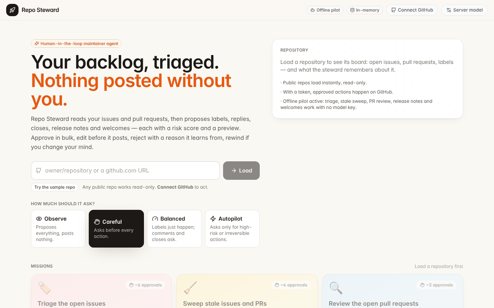

# 🛠️ Repo Steward — a maintainer agent that asks before it acts

[](https://github.com/KirtiJha/langgraph-interrupt-workflow-template/actions/workflows/ci.yml)
[](https://docs.langchain.com/oss/python/langgraph/overview)
[](https://docs.langchain.com/oss/python/langchain/overview)
[](https://fastapi.tiangolo.com/)
[](https://nextjs.org/)
[](https://www.python.org/)
[](https://opensource.org/licenses/MIT)

**Your backlog, triaged. Nothing posted without you.**

Repo Steward is an agent for GitHub maintainers. Point it at a repository and
it triages issues, reviews pull requests, sweeps stale threads, drafts release
notes and welcomes first-time contributors — and **pauses for your approval
before anything public happens**. Every proposed action comes with a risk
score and a preview of exactly what will be posted. Approve in bulk, edit before
it posts, reject with a reason it learns from, rewind if you change your mind.

It is also a complete, production-shaped reference for **human-in-the-loop
agents on LangGraph v1 + LangChain v1**: per-call interrupts, a risk policy that
reads live state, time travel, durable Postgres threads, bring-your-own model
and evals that score *asked before acting*.

<p align="center">
  
</p>

> **Try it on any public repository with nothing configured.** Public repos
> load read-only and every action becomes a proposal. Connect a GitHub token
> to act. The five starter missions run on a rule-based offline pilot, so no
> model key is needed either; add one (in the UI or the env) for open-ended goals.

**Live demo:** [langgraph-hitl.vercel.app](https://langgraph-hitl.vercel.app)

[](https://codespaces.new/KirtiJha/langgraph-interrupt-workflow-template)

---

## ✨ What it does

| Mission | What the steward proposes | Risk it flags |
|---|---|---|
| 🏷️ **Triage the open issues** | Labels (bug / enhancement / question / docs), duplicates closed with a pointer to the original, repro requests on thin bug reports, answers from the README and code | Public comments; closing threads |
| 🧹 **Sweep stale issues and PRs** | Closes what the thread shows is resolved, labels and nudges the rest, asks PR authors about rebases | Closing someone's PR is high risk; active threads |
| 🔍 **Review the open pull requests** | A grounded summary per PR from its diff stats, a welcome for first-timers, review requests where it's ready | Tone with first-time contributors |
| 🚀 **Draft the release notes** | Commits since the last tag grouped into fixes, features, docs and internal, contributors credited, posted as a tracking issue | Opening a public issue |
| 👋 **Welcome first-time contributors** | Thanks and a pointer to CONTRIBUTING.md; small docs issues labelled *good first issue* | Public comments |
| ✍️ **Your own goal** | Anything, with a real model: "relabel issues that are really feature requests", "answer every question from the docs" | Scored per action like the rest |

**Four decisions on every action:** Approve · Edit (schema-driven form; the
edited call is what runs) · Reject with a reason · Reply instead. Hotkeys
**A / E / R**, "Approve all", and per-thread approve when a triage touches forty
issues.

**Four autonomy levels:** *Observe* proposes everything and posts nothing
(the default without write access; copy the proposals as a Markdown checklist).
*Careful* asks before every action. *Balanced* lets labels and assignments
through and asks for comments, closes and new issues. *Autopilot* asks only for
high-risk or irreversible actions (merges, closing PRs, active threads).

**Time travel:** branch from any decision point; the board rewinds and the
approvals come back for new answers. On a live repo, what's already posted
stays posted — the UI says so.

**Built for every screen.** Phones get a collapsible decision sheet that shows
one action at a time; tablets get the feed beside the board; laptops get all
three panes. Light and dark themes follow your system (or the toggle). Click any
issue for a drawer with its thread and the actions pending on it; filter the
board; filter decisions by risk and approve all low-risk ones in one go.
Keyboard: **J / K** move between actions, **A / E / R** act, **Shift + A**
approve all, **L** approve low-risk, **?** for the full list.

**Memory:** missions leave per-repository notes ("uses `needs-repro`") that
shape the next one.

## 🧭 How it works

```
┌────────────────────┐   SSE    ┌──────────────────────────┐        ┌──────────────────────────┐
│ Next.js UI         │ ◄──────► │ FastAPI  /missions/*     │ ─────► │ LangGraph create_agent   │
│ • repo picker      │          │ • X-GitHub-Token, X-LLM-*│        │ • board in state         │
│ • feed + decisions │          │ • start / decide / fork  │        │ • HITL middleware (when) │
│ • board with ghosts│          │ • /repos/inspect         │ ◄────► │ • GitHub REST / fixture  │
└────────────────────┘          └──────────────────────────┘        └──────────────────────────┘
```

- **The board lives in graph state.** At mission start the repo's open issues,
  pull requests, labels and README are loaded into `state["world"]`. Acting
  tools (`add_labels`, `comment`, `close_issue`, `create_issue`, `merge_pull`…)
  execute on GitHub and return an *operation*; a reducer applies it to the
  board. That is why the board is checkpointed, rewinds with time travel and
  forks cleanly, and why the UI can draw pending actions as ghosts.
- **The risk policy reads state.** `HumanInTheLoopMiddleware(interrupt_mode="per_call")`
  gates the acting tools with a `when` predicate from `backend/steward/policy.py`:
  it scores the call against the board (is the author a first-timer? is the
  thread active? is it a PR? how many people are mentioned?) and the autonomy
  level, records the assessment for the UI, and decides whether to pause.
- **Credentials never touch the server's storage.** The visitor's GitHub token
  and model key arrive as headers, are scoped to the request with a ContextVar,
  and are scrubbed from error messages.
- **Observe mode is a first-class outcome.** Without a write token (or with
  *Observe* chosen), approved actions are recorded as proposals in the ledger
  and the report; nothing is posted.
- **The offline pilot** (`backend/steward/pilot.py`) is a rule-based model:
  wording-based classification, keyword-overlap duplicate detection,
  date-based staleness, diff-stat PR summaries, commit-message release notes.
  It reacts to your decisions like a real model would. It can't answer questions
  from code; that needs a real model.

## ⚡ Quick start (zero config)

```bash
# 1. Backend
cd backend
python -m venv .venv && source .venv/bin/activate   # Windows: .venv\Scripts\activate
pip install -r requirements.txt
cp .env.example .env            # works as-is
python main.py                  # http://localhost:8000  (docs at /docs)

# 2. Frontend (new terminal)
cd frontend
npm install
npm run dev                     # http://localhost:3000
```

Open http://localhost:3000, click **Try the sample repo**, launch **Triage the
open issues**, and decide. Then paste any public repository of your own.

### Acting on a real repository

1. Create a [fine-grained token](https://github.com/settings/personal-access-tokens/new)
   scoped to the repositories you want managed, with **Issues: read & write**
   and **Pull requests: read & write**.
2. Click **Connect GitHub** in the header and paste it. It stays in your
   browser (session storage, or local storage if you tick *Remember*).
3. Load the repo — the badge flips to **write access** — and pick an autonomy
   level. Approved actions now happen on GitHub, with links in the feed.

Server-side alternative for a personal deployment: set `GITHUB_TOKEN` (used
for reads: 5,000 requests/hour instead of 60) and `STEWARD_SERVER_TOKEN_WRITES=true`
to let it act too.

## 🔌 Use a real model — any provider

**From the UI (no restart):** **Model** in the header → pick a provider, type or
pick a model, paste your key, **Test connection**, **Save**. Sent as
`X-LLM-*` headers per request; never stored.

**From the environment:** one of

```env
AI_GATEWAY_API_KEY=...  LLM_MODEL=anthropic/claude-sonnet-4.6      # Vercel AI Gateway: one key, every provider
LLM_MODEL=anthropic:claude-sonnet-4-5                               # + ANTHROPIC_API_KEY (or openai / google_genai)
LLM_BASE_URL=https://openrouter.ai/api/v1  LLM_API_KEY=...  LLM_MODEL=meta-llama/llama-3.3-70b-instruct
```

| Owner control | Effect | Default |
|---|---|---|
| `LLM_CLIENT_CONFIG` | `false` ignores model settings from the browser | `true` |
| `LLM_CLIENT_CAN_USE_SERVER_KEY` | Let a browser-chosen model use the server's key | `false` |
| `LLM_CLIENT_ALLOW_PRIVATE_HOSTS` | Allow custom base URLs on private addresses | `true` locally, `false` on Vercel |

## ▲ Deploy to Vercel

Two projects from this repo: `frontend/` (Next.js) and `backend/` (FastAPI,
zero-config, SSE + lifespan).

> **A database is required on Vercel** so a mission paused by one serverless
> request can be resumed by another. Add **Storage → Neon** to the backend
> project (sets `DATABASE_URL`); without it resumes fail with a clear 404.

1. **Backend** — import → **Root Directory: `backend`** → Deploy → Storage → Neon. Optional: `GITHUB_TOKEN` for higher read limits, a default model, `CORS_ORIGINS`.
2. **Frontend** — import again → **Root Directory: `frontend`** → `NEXT_PUBLIC_API_URL=https://<backend>.vercel.app`.

[](https://vercel.com/new/clone?repository-url=https%3A%2F%2Fgithub.com%2FKirtiJha%2Flanggraph-interrupt-workflow-template%2Ftree%2Fmain%2Fbackend&project-name=repo-steward-backend&repository-name=repo-steward-backend&env=GITHUB_TOKEN&envDescription=Optional%3A%20a%20GitHub%20token%20for%205%2C000%20reads%2Fhour.%20Then%20add%20a%20Neon%20database%20from%20the%20Storage%20tab.)
[](https://vercel.com/new/clone?repository-url=https%3A%2F%2Fgithub.com%2FKirtiJha%2Flanggraph-interrupt-workflow-template%2Ftree%2Fmain%2Ffrontend&project-name=repo-steward&repository-name=repo-steward&env=NEXT_PUBLIC_API_URL&envDescription=URL%20of%20your%20deployed%20backend)

See [docs/DEPLOYMENT.md](docs/DEPLOYMENT.md) for Docker, LangGraph Platform
and self-hosted Postgres.

## 🛡️ Production layers

All optional, all env-configured, all degrade gracefully.

- **Guardrails** (`guardrails.py`) — masks cards, SSNs and phone numbers before the model sees them (emails too with `GUARDRAILS_REDACT_EMAILS=true`); refuses blocklisted input.
- **Middleware power-pack** (`middleware_pack.py`) — summarisation, call limits, model retry, optional fallback model.
- **Graceful cancel** (`run_control.py`) — **Pause** drains the run at a safe boundary; the mission stays resumable.
- **Second-opinion risk gate** — `HITL_RISK_CLASSIFIER=jev` adds [TypeSafe AI's Jev](https://typesafe.ai) decision model; when it flags an action the policy let through, the steward asks. Falls back to a regex without a key.
- **MCP tools** — `MCP_SERVERS` adds any Model Context Protocol server's tools; the policy treats them as acting tools of medium risk.
- **Rate limits** — `LLM_REQUESTS_PER_SECOND` smooths bursts; GitHub rate-limit errors tell the user to connect a token.

`GET /capabilities` reports what's active.

## 🔭 LangGraph Studio & AG-UI

```bash
pip install "langgraph-cli[inmem]" && langgraph dev     # Studio with the mission graph
```

The agent is also exposed over the [AG-UI protocol](https://docs.ag-ui.com) at
`/agui` for CopilotKit-style clients — see [`examples/copilotkit`](examples/copilotkit).

## 📡 API reference

| Endpoint | Method | Description |
|---|---|---|
| `/repos/inspect?repo=` | GET | Validate a slug or URL, load the board, report `mode`, `can_write`, rate limit and per-repo memories |
| `/missions` | GET | Starter missions and the sample repository |
| `/missions/start` | POST | `{repo, goal, mission_id?, user_id?, autonomy}` — SSE. Forced to `observe` without write access |
| `/missions/{id}/decide` | POST | `{decisions: {interrupt_id: decision}}` — approvals (`approve` / `edit` / `reject` / `respond`) and answers, any subset — SSE |
| `/missions/{id}/continue` | POST | A follow-up goal on the same thread and board — SSE |
| `/missions/{id}/fork` | POST | Branch from a decision point — SSE |
| `/missions/{id}/cancel` | POST | Graceful pause |
| `/missions/{id}`, `/timeline`, `/history` | GET | State (board, pending with risk + preview, report), the feed, decision points |
| `/model/providers`, `/model/test` | GET, POST | Provider presets; test the model in the request's `X-LLM-*` headers |
| `/capabilities`, `/health`, `/agui` | | |

Headers: `X-GitHub-Token` (visitor's token), `X-LLM-Provider` / `X-LLM-Model` / `X-LLM-API-Key` / `X-LLM-Base-URL` (model settings).

## ⚙️ Configuration

| Variable | Description | Default |
|---|---|---|
| `GITHUB_TOKEN` | Server-side token for reads (5,000/h) | – (60/h unauthenticated) |
| `STEWARD_SERVER_TOKEN_WRITES` | Let the server token act when a visitor has none | `false` |
| `LLM_MODEL` / `LLM_PROVIDER` / `AI_GATEWAY_API_KEY` / `LLM_BASE_URL` / `LLM_API_KEY` | The server's default model | offline pilot |
| `LLM_CLIENT_CONFIG` / `LLM_CLIENT_CAN_USE_SERVER_KEY` / `LLM_CLIENT_ALLOW_PRIVATE_HOSTS` | Model choice from the UI | `true` / `false` / local only |
| `USE_MOCK_LLM` | Force the offline pilot | `false` |
| `DATABASE_URL` (or `POSTGRES_URL`) | Postgres checkpointer + store — **required on Vercel** | – |
| `CHECKPOINT_DB` | Durable SQLite for a single server | in-memory |
| `HITL_RISK_CLASSIFIER` / `HITL_RISK_CONFIDENCE` | `patterns` or `jev` second opinion | `patterns` / `0.75` |
| `GUARDRAILS_ENABLED` / `GUARDRAILS_REDACT_PII` / `GUARDRAILS_REDACT_EMAILS` / `GUARDRAILS_BLOCKLIST` | Guardrail middleware | `true` / `true` / `false` / – |
| `AGENT_MODEL_CALL_LIMIT` / `AGENT_FALLBACK_MODEL` / `EMBEDDINGS_MODEL` / `MCP_SERVERS` / `LLM_REQUESTS_PER_SECOND` | Power-pack, memory, MCP, rate cap | `25` / – / – / – / off |
| `CORS_ORIGINS` / `PORT` | | `*` / `8000` |

## 🎨 Make it yours

- **Your policy.** `backend/steward/policy.py:assess()` is one function per tool; change what counts as risky for your project.
- **Your missions.** Add to `MISSIONS` in `backend/steward/catalog.py`; add a script to `pilot.py` if it should work offline.
- **Your tools.** `backend/steward/tools.py` — add a tool, return a `Command` with an operation, teach `world.py` to apply it. Or load tools from MCP.
- **Another platform.** `steward/github.py` is the only file that knows about GitHub's API; GitLab or Jira are a backend away.
- **Your look.** Design tokens in `frontend/app/globals.css` and `tailwind.config.js`.

## 🧪 Testing & evaluation

```bash
cd backend
USE_MOCK_LLM=true pytest -q                  # API, policy, autonomy, observe mode, fork, tokens — offline
TEST_GITHUB_LIVE=1 pytest -q -k live         # read a real public repo
python -m evals.run_evals                    # asked_before_acting, no_forbidden_actions, used_expected_tools… (offline OK)
python -m evals.run_evals --langsmith        # tracked experiment (LANGSMITH_API_KEY)
```

See [docs/EVALUATION.md](docs/EVALUATION.md).

## 📁 Project structure

```
├── backend/
│   ├── main.py                 # FastAPI: /repos/inspect, /missions/*, /model/*, SSE
│   ├── steward/
│   │   ├── github.py           # real REST backend + fixture backend; token scoping and scrubbing
│   │   ├── world.py            # the repo board in state: reducer for label/comment/close/… operations
│   │   ├── tools.py            # reading + acting tools (execute → operation), ask_user, remember
│   │   ├── policy.py           # risk assessment, autonomy levels, previews → InterruptOnConfig.when
│   │   ├── pilot.py            # rule-based offline model for the starter missions
│   │   ├── fixture.py          # the acme/pixelforge sample repo
│   │   ├── catalog.py          # starter missions
│   │   └── agent.py            # create_agent + HITL + BYO model; stream, fork, history
│   ├── client_model.py · llm.py · persistence.py · approval_policy.py · guardrails.py · middleware_pack.py · …
│   ├── evals/                  # dataset + evaluators + runner
│   └── test_main.py · test_infra.py · test_evals.py
├── frontend/
│   ├── app/page.tsx            # header, gallery ↔ workspace
│   ├── components/             # Gallery, Workspace, Feed, ApprovalCard, QuestionCard, BoardPanel, MissionPanel, ConnectGitHub, ModelSettings
│   └── lib/                    # api.ts, useMission.ts, github.ts, modelSettings.ts
├── docs/ · examples/copilotkit · scripts/record_demo.py · langgraph.json · docker-compose.yml
```

## 🤝 Contributing · 📝 License

Contributions welcome — see [CONTRIBUTING.md](CONTRIBUTING.md). MIT — see [LICENSE](LICENSE).

## 🔗 Resources

- [LangGraph docs](https://docs.langchain.com/oss/python/langgraph/overview) · [Human-in-the-loop guide](https://docs.langchain.com/oss/python/langchain/human-in-the-loop) · [Time travel](https://docs.langchain.com/oss/python/langgraph/use-time-travel)
- [GitHub REST API](https://docs.github.com/en/rest) · [Fine-grained tokens](https://docs.github.com/en/authentication/keeping-your-account-and-data-secure/managing-your-personal-access-tokens) · [AG-UI](https://docs.ag-ui.com) · [MCP](https://modelcontextprotocol.io)
